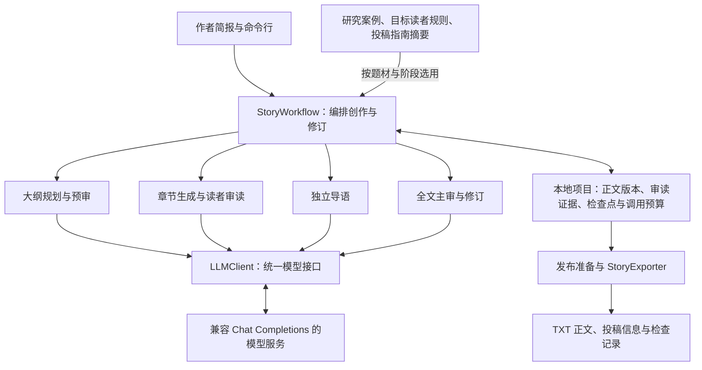

# 短篇工作流

`StoryWorkflow` 编排同一个创作项目。模型通过 `LLMClient.generate(prompt, task_type)` 接入；标准实现支持 OpenAI Chat Completions 格式。

## 模块协作

图中的模块通过同一工作流调用模型；不同写作和审读任务使用各自的提示词与校验规则。作者可以在大纲阶段查看方案，确认后再执行全文生成。

| 实现位置（相对于 `ShortFictionAgent/short_fiction_agent/`） | 职责 |
| --- | --- |
| `story_studio/cli.py`、`workflow.py` | 命令入口与阶段编排 |
| `story_studio/scene_planning.py`、`plan_preview.py` | 场景规划与可供作者查看的方案 |
| `story_studio/chapter_production.py`、`chapter_reader.py` | 逐章生成、审读与章节修订 |
| `story_studio/lead.py` | 从正文选材并生成导语 |
| `story_studio/chief_editor.py`、`structural_revision.py` | 全文主审与结构修订 |
| `story_studio/research_guidance.py`、`submission_guide.py`、`data/` | 按阶段提供研究经验与投稿要求 |
| `story_studio/storage.py`、`run_control.py` | 项目状态、版本、检查点和调用预算 |
| `story_studio/publication.py`、`channels.py` | 发布准备与投稿包导出 |
| `llm.py` | 模型请求与响应 |

## 阶段与检查

| 阶段 | 保存与检查的内容 |
| --- | --- |
| 作者简报 | 题材、视角、读者期待、篇幅、硬事实、投稿渠道 |
| 选题与入口 | 候选方案、比较依据、选中方案及输入指纹 |
| 大纲预审 | 场景因果、章节节拍、冲突和回报、导语可用素材 |
| 逐章写作 | 当前剧情、人物状态、完整场景与章节检查点 |
| 导语 | 正文选材、必要信息、后续期待及与第一章衔接 |
| 全文主审 | 连续阅读、具体问题及原文证据、事实与结尾兑现 |
| 修订与发布 | 新正文版本、复核、标题简介、TXT 及审读记录 |

研究数据按题材与阶段选入提示，不要求所有故事使用同一种反派、固定反转次数或相同钩子。大纲与审读区分具体事件和作者自评，不能只凭“有冲突”“很甜”“已兑现”判通过。

项目文件保存在用户指定目录；合同、正文和模型结果有版本与内容指纹。变更影响相应检查记录，旧通过结论不能直接移用于新稿。调用额度与停止状态独立保存，修订不会清空预算。

## 未通过时如何处理

默认短篇流程写完一章即审读，通过后才继续下一章。局部问题先修订本章；涉及情节结构、回报不足或跨章重复的问题会保存退回大纲的请求。修订后的实际正文成为下一章的衔接依据。

全文主审检查主线、节奏、导语承诺和结局兑现；修订后按新版本复核。正式导出还需通过发布准备。超出修订次数或调用预算时，工作流保存当前进度并停止，作者可查看问题后继续处理。
